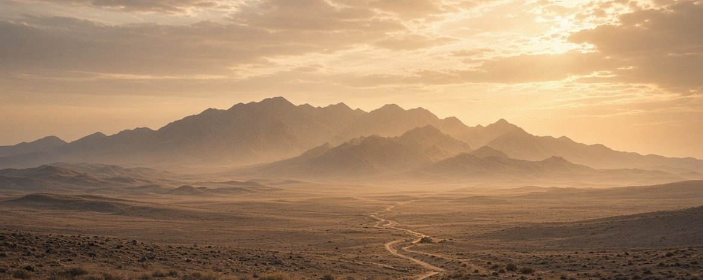

> *"God resisteth the proud, and giveth grace to the humble. Humble yourselves therefore under the mighty hand of God, that he may exalt you in due time: Casting all your care upon him; for he careth for you."* - 1 Peter 5:5-7 (KJV)

---

The Lord keeps closing doors on me.

For many weeks now, I've been puzzled by the consistent lack of traction I've been experiencing since moving to LA. It seems as though I have been quite successful in every area except the one area I actually need to stay here; work/finances. 

Making new friends? Check. Finding a solid new church to attend? Check. Beginning to build a life here? Check. Anything at all resembling basic financial stability? Absolutely not. No matter what avenue I pursue, no matter how ambitious/menial, no matter how optimistic it looks, circumstances have not worked in my favor in this way. It's gotten to the point where several people have offered me positions, only to rescind the offer due to material changes in their circumstances (one guy lost about $50,000 worth of work the day after he offered me the job). To be blunt, it has started to feel less like a temporary setback, and more like a divinely orchestrated wilderness.

This, naturally, has led me to question everything I thought about being down here. Did I make a mistake coming here? Did I miss some big warning sign that the Lord would have used to prevent me from coming here? Or have I done something that needs correcting? Is there some lesson I need to learn in the desert? 

---

If you asked me my stance on decision making and God's will over the past few years, I would have regurgitated something similar to the quote often attributed to St. Ignatius (or sometimes St. Augustine):

> *"Pray as though everything depended on God; act as though everything depended on you."*

I have always considered ambition and striving to be good things, and acted as such. We are created to work and hold dominion after all. But the more dominoes that fall, the more I become convinced that I was in error. Godly ambition is instrumental, but the more that I act as though everything depends on me, the more I cease to depend on God. The two have been mutually exclusive in my life. Through my pride, I convinced myself that it really is all up to me. As though the success of this mission was in my hands, and not His. 

The gall. 

For the past couple weeks or so, the topic of pride has kept popping up, and I couldn't for the life of me figure out why. A Bible study here, a men's conference there, and then this morning: the cherry on top. I walk into church and read the title of the sermon in the bulletin;*The Grace of Learning Gratitude in the Desert.*

Ever have those moments where a few words on a page completely reorient your thinking? The instant I saw the words *"in the Desert"*, I knew I was in for a ride. Pastor opens to Deuteronomy chapter 8 and starts reading: 

> *"And thou shalt remember all the way which the LORD thy God led thee these forty years in the wilderness, to humble thee, and to prove thee, to know what was in thine heart, whether thou wouldest keep his commandments, or no." - Deuteronomy 8:2 (KJV)*

My sin here hasn't been obvious. To most people looking at me from outside I look like a model Christian. This is true in some ways, I try very earnestly to practice what I preach, but it misses the point. To both myself and the people around me, my pride was invisible, masked expertly by a veneer of hard work, discipline, and godly ambition. But I was entitled.

I had taken material risks on faith, and convinced myself that God owed me my preferred version of success as a result. As though I was entitled to God's specific provisions.

The gall.

---

My reason for writing this out is threefold:

1. *"And thou shalt remember all the way which the LORD thy God led thee these forty years in the wilderness."* It's become clear that I need a record of this trip. We are a fickle and feckless species, and we are eminently good at repeating past mistakes. He who forgets history and all that.
2. *"A man's heart deviseth his way: but the LORD directeth his steps."* I hope to offer encouragement to those brothers/sisters who may be living something similar. Our strivings are good, and ambition is good, but it cannot replace our reliance on the Most High. 
3. *"Confess your faults one to another, and pray one for another, that ye may be healed. The effectual fervent prayer of a righteous man availeth much."* Public confession is good. Admittedly, this is third on the list because I don't anticipate many will actually read this. That being said, if anyone does read this, please keep me in your prayers.

I have no idea what the Lord is going to do with me. I have no idea where He is going to take me next. I have no doubt that things will play out in ways that I cannot possibly see coming. I know it will be good, though. 

*Not my will but yours be done, on Earth as it is in Heaven.*
