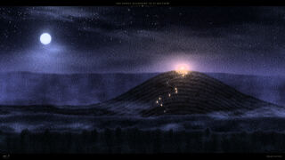
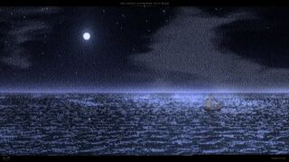
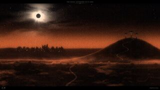
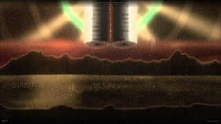

<iframe src="../bible/john/" title="John, drawn in its own letters" loading="lazy" tabindex="-1"></iframe>
<button class="live-cover" type="button">Click, then scroll or pinch to zoom and drag to look around</button>

<button class="book" data-book="matthew" data-at="5:14" aria-pressed="false">

Matthew5:14 · A city on a hill at night
</button>
<button class="book" data-book="mark" data-at="4:39" aria-pressed="false">

Mark4:39 · The storm, then the calm
</button>
<button class="book" data-book="luke" data-at="23:44" aria-pressed="false">

Luke23:44 · Darkness over Calvary
</button>
<button class="book on" data-book="john" data-at="8:12" aria-pressed="true">

John8:12 · The light of the world
</button>
<button class="book" data-book="acts" data-at="2:3" aria-pressed="false">

Acts2:3 · Tongues of fire
</button>
<button class="book" data-book="revelation" data-at="6:14" aria-pressed="false">

Revelation6:14 · Heaven rolled up like a scroll
</button>

> All scripture is given by inspiration of God, and is profitable for doctrine, for reproof,
> for correction, for instruction in righteousness.
>
> 2 Timothy 3:16

Scripture rendered as art. The words of our God visually represented through code. Zoom or pinch to read different sections, or just sit back and enjoy the view.

<a class="cta" href="../bible/">See all the books ›</a>

- **Books so far:** Matthew, Mark, Luke, John, Acts, Revelation
- **Built with:** WebGL2, one page per book

