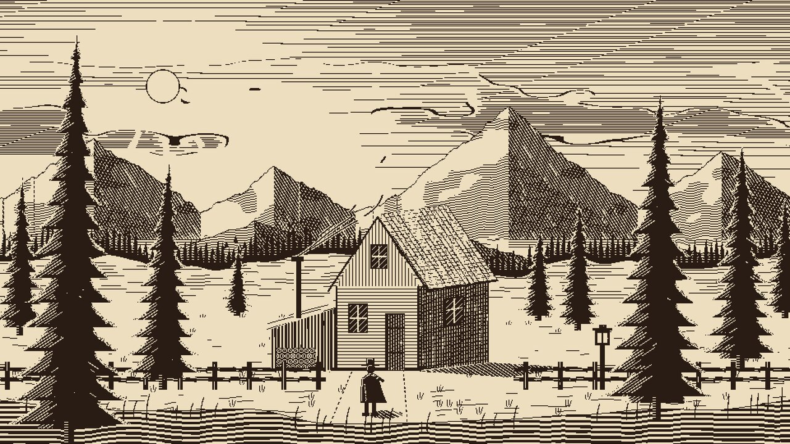
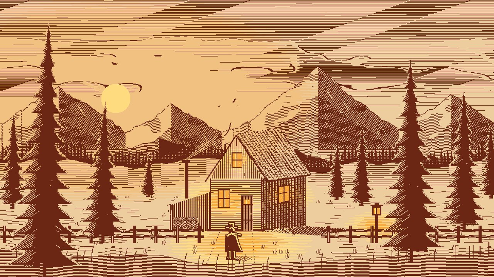
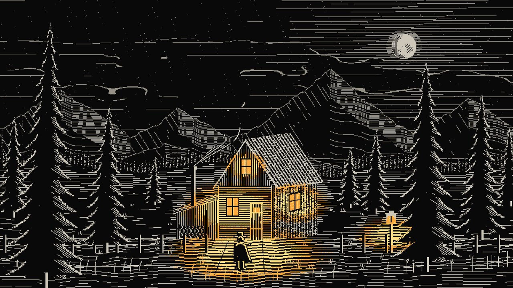
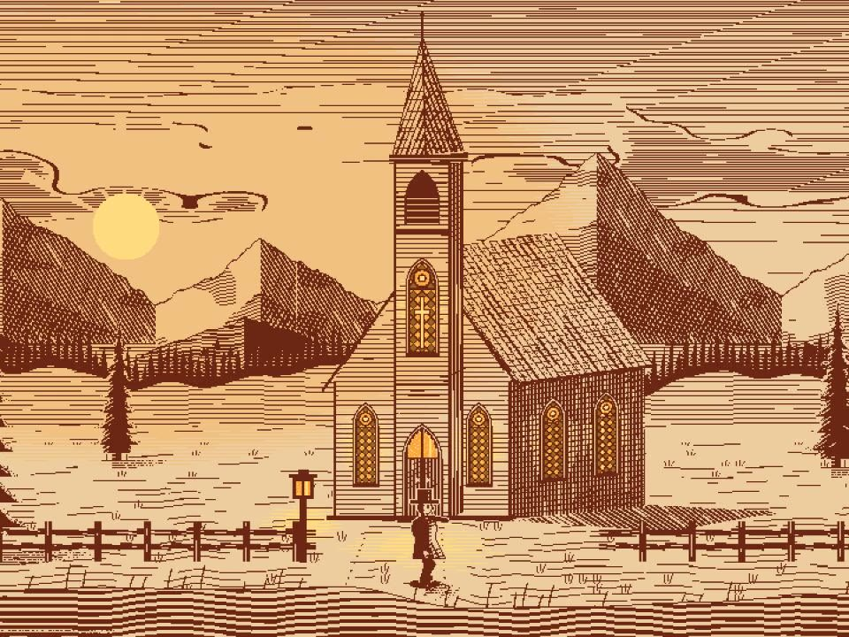
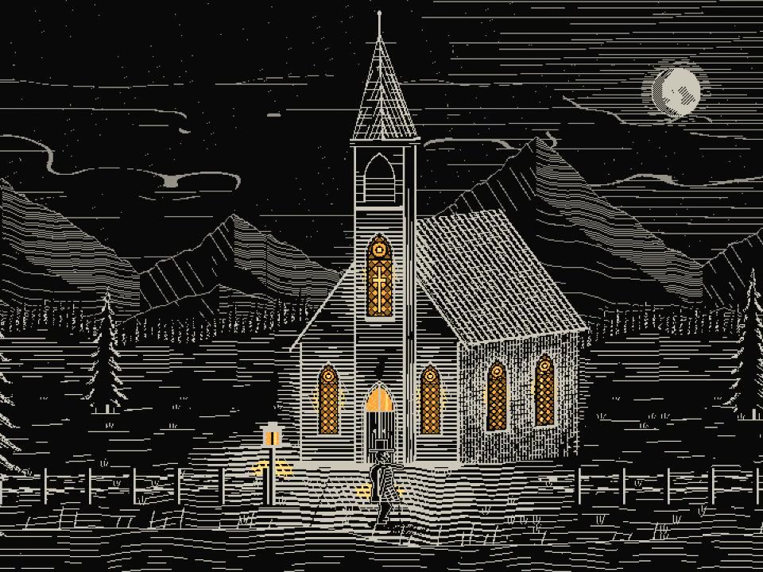
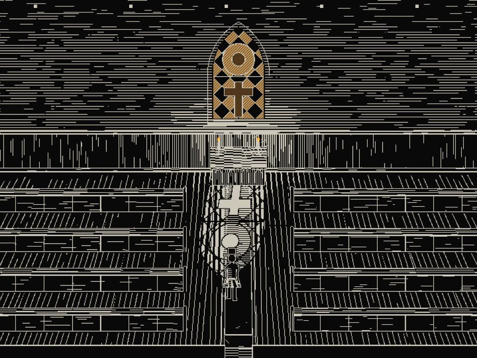

<video autoplay loop muted playsinline poster="../assets/media/contrition-church-night.jpg" src="../assets/media/contrition-motion.mp4"></video>

> For we wrestle not against flesh and blood, but against principalities, against powers, against the
> rulers of the darkness of this world, against spiritual wickedness in high places.
>
> Ephesians 6:12

How would Christ appear in another world? C.S. Lewis answered that question by imagining Aslan in the world of Narnia. I ask the same question, but of a very different world.

A 2D game where the story comes first and your choices matter. If you've played *FAITH: The Unholy Trinity* or *Undertale*,
it's in that family. It's dark and the evil is real, so make your choices count.

*These stills are from the game. The art isn't final.*

- **Platform:** PC
- **Built with:** Godot 4.7
